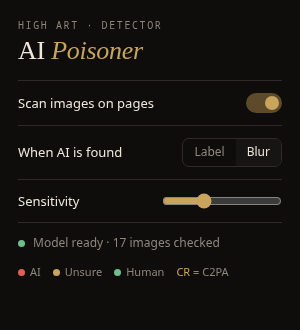

# AI Poisoner: AI image detector for Chrome

A browser extension that labels images on any web page as **AI**, **Unsure**, or **Human**, live, as you scroll.
Everything runs **on your own computer**. Images are never uploaded anywhere.



It's the desktop prototype of the *AI Data Poisoner & Detector* design-thinking project (Capture → Processing → Overlay).

---

## Install guide

Works in **Google Chrome, Microsoft Edge, Brave, Opera, Vivaldi** and other Chromium browsers.
It isn't on the Chrome Web Store yet, so you install it in developer mode. It takes about a minute.

### 1. Download

Go to the [**latest release**](https://github.com/YajatGhule/ai-poisoner/releases/latest) and download
**`ai-poisoner-v0.1.0.zip`**. Don't use the green "Code → Download ZIP" button: that version is missing
the AI runtime files and won't work.

### 2. Unzip it somewhere permanent

Extract the zip into a folder you won't delete, for example `Documents/ai-poisoner`.
The browser loads the extension from this folder every time it starts, so **if you delete the folder, the extension stops working**.

When you open the folder, you should see `manifest.json` directly inside it.

### 3. Load it into your browser

| Browser | Open this address | Then |
|---|---|---|
| Chrome | `chrome://extensions` | turn on **Developer mode** (top right) |
| Edge | `edge://extensions` | turn on **Developer mode** (left sidebar) |
| Brave | `brave://extensions` | turn on **Developer mode** (top right) |

Click **Load unpacked** and select the folder from step 2 (the one that contains `manifest.json`).

### 4. Pin it and try it

Click the puzzle-piece icon in the toolbar, then click the pin next to **AI Poisoner**.
Open any page with pictures. The **first time**, the extension downloads its detection model
(about 90 MB, only once). Click the extension icon to see the progress. After that, badges appear on images as you scroll.

### Using it

| Badge | Meaning |
|---|---|
| 🔴 **AI 92%** | Probably AI-generated |
| 🟡 **Unsure 70%** | Could go either way |
| 🟢 **Human** | Probably a real photo or human-made |
| **CR** chip | The file carries C2PA *Content Credentials* (provenance data) |

- **Hover** a badge to see why it decided that.
- **Click** a badge to re-check the image from what's on screen.
- In the popup, switch **When AI is found** to **Blur** to blur AI images. Click the badge to reveal one.
- **Sensitivity** sets how sure the model must be before it says "AI".

### Updating

Download the new release zip, replace the contents of your folder with it, then click the ↻ reload icon on the
extension's card in `chrome://extensions`.

### Troubleshooting

- **"Manifest file is missing or unreadable"**: you selected the wrong folder. Pick the one that has `manifest.json` directly inside it, not its parent.
- **Chrome shows "Disable developer mode extensions" on startup**: this is normal for extensions loaded this way. Click the ✕ to keep it.
- **No badges appear**: check the extension is switched on in the popup and the model status says *ready*. Badges skip images smaller than 80 px, and browsers block extensions on pages like `chrome://` and the Web Store.
- **Model stuck at "Downloading"**: the model comes from huggingface.co, so make sure that site isn't blocked on your network. Reload the extension and try again.

To **uninstall**, click **Remove** on its card in `chrome://extensions`.

---

## How it works

```
content.js      finds /<video> on the page → badge overlay (shadow DOM, fixed position)
   │
background.js   service worker: routes requests, takes tab screenshots for the fallback path
   │
offscreen.js    runs the model (transformers.js + ONNX Runtime WASM) and the metadata check
```

Each image is checked in two steps:

1. **Provenance metadata (exact).** The extension fetches the original file and looks for the IPTC
   `trainedAlgorithmicMedia` tag, which OpenAI, Google, Adobe, Meta and others write. It also looks for
   "Made with Google AI", Stable Diffusion / ComfyUI generation settings, and C2PA content credentials.
   When any of these are found, the verdict is certain.
2. **Classifier (estimate).** If there's no metadata, a ViT model
   ([`onnx-community/ai-image-detection-ONNX`](https://huggingface.co/onnx-community/ai-image-detection-ONNX), 8-bit)
   gives a probability. Below 60% shows *Human*, 85% and above shows *AI*, and anything in between shows *Unsure*.
   The Sensitivity slider moves these thresholds.

If a site refuses to serve the image file to the extension, or for `<video>`, the extension screenshots just that
box on screen and classifies the pixels instead.

## Limits, honestly

- The classifier is a **hint, not proof**. On a small test set (20 AI and 16 real images from Wikimedia Commons)
  it ranked AI above real 87% of the time (AUC 0.87). At the default threshold it caught about half the AI images
  and wrongly flagged about 1 in 16 real photos. Newer generators and heavy compression make it worse.
- Social sites strip metadata from uploads, so the exact metadata check mostly helps with original files
  (news sites, stock photos, Wikimedia Commons, direct links).

## Building from source

Needs Node.js and pnpm.

```sh
pnpm install
pnpm build          # copies transformers.js + ONNX Runtime WASM into extension/lib
pnpm package        # dist/ai-poisoner-v<version>.zip, the file attached to releases
```

Then use **Load unpacked** on the `extension/` folder. `pnpm eval <dir>` scores a folder that has `ai/` and `real/`
subfolders, so you can compare other models.

## Android app

[`android/`](android/) has the phone version: the same image labels in **any app** (through an Accessibility
Service), plus a **voice check** that listens to the mic or to other apps' audio, transcribes it live, and estimates
whether the voice is AI-generated, using [a detector trained for this project](android/voice-model/README.md)
(on held-out voices: 0–2% of real voices flagged, 72–100% of AI voices caught).
It's **source only for now** (type-checked, not built yet). See
[android/README.md](android/README.md) for how it works and how to build it.

## Not built yet

- **Poisoner**: protect your own uploads (Glaze/Nightshade-style perturbation, e.g. Mist or PhotoGuard on a GPU backend).
- Continuous video scanning in the extension (videos are currently checked once, from a screenshot).
